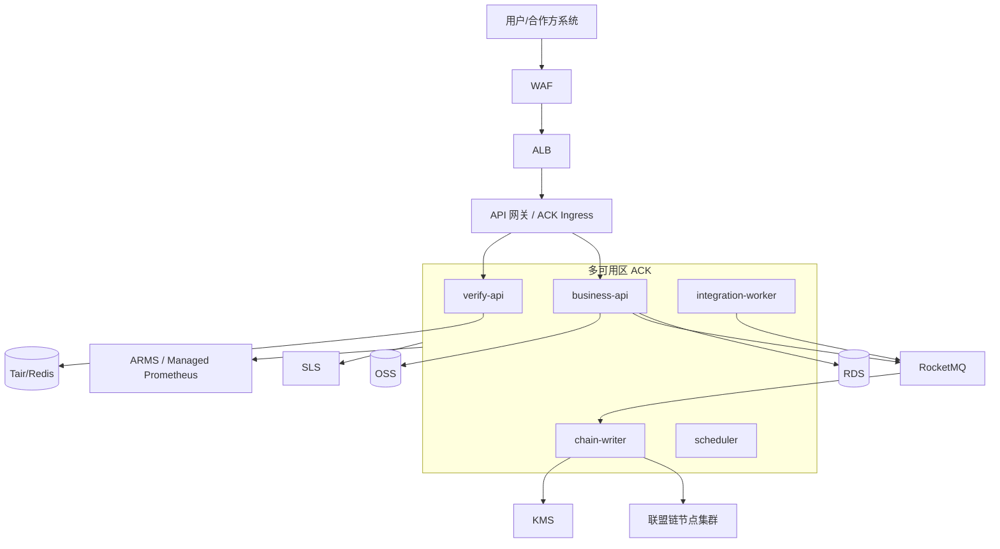

# 应用部署架构

本文记录珠宝区块链跟踪系统的业务应用部署方案，作为 `jewelry-platform`、`jewelry-infra` 与 `jewelry-ledger` 的交付边界参考。

## 1. 总体入口链路

生产入口采用：WAF → ALB/API 网关 → 多可用区 ACK。

## 2. 部署单元职责

| 部署单元 | 职责 | MVP 副本 | 扩容策略 |
| --- | --- | ---: | --- |
| `business-api` | 品牌方、鉴定机构、经销商业务写入与管理 API | 2 | 基于 CPU、错误率和请求量 HPA |
| `verify-api` | 消费者验真和公开溯源查询 API | 2 | 基于 QPS、P95 延迟和 CPU HPA |
| `chain-writer` | 消费 RocketMQ 事件并异步写入联盟链 | 2 | 基于消息积压和上链延迟扩容 |
| `integration-worker` | 外部物流、标签、机构事件接入与标准化 | 2 | 基于外部事件量和失败重试积压扩容 |
| `scheduler` | 补偿、对账、链写入重试和归档任务 | 1 | 默认单副本，任务需幂等，必要时引入分布式锁 |

## 3. 数据与中间件

- RDS 保存业务主数据、事件、权限、订单索引和链上回写状态。
- Tair/Redis 保存热点验真视图、短期限流计数和可重建缓存。
- RocketMQ 承载 `TraceEventCreated`、`ChainTxConfirmed` 等异步事件。
- OSS 保存证书、报告、图片和导出文件，业务库和链上只保存摘要与索引。
- KMS 管理签名密钥、数据加密密钥和敏感配置引用。
- SLS 采集应用日志、审计日志和链写入日志。
- ARMS/Managed Prometheus 采集应用、ACK、消息积压和上链延迟指标。

## 4. 区块链隔离部署

区块链节点与业务应用隔离部署。MVP 可先部署在独立节点池；生产增强建议单独 ACK 集群或独立 ECS 节点，并使用独立安全组、子网和访问策略。

隔离原则：

1. 业务 API 不直接暴露链节点管理端口。
2. `chain-writer` 是业务应用写链的唯一入口。
3. 链节点密钥、MSP、证书和通道配置不进入业务应用镜像。
4. 审计方只读节点或快照通道独立授权。

## 5. 异步上链一致性

业务写入采用先落库后异步上链：

1. `business-api` 或 `integration-worker` 校验权限和幂等键。
2. 业务事件写入 RDS，状态为 `PENDING_CHAIN`。
3. 事件投递 RocketMQ。
4. `chain-writer` 消费消息，调用签名与链 SDK 写入联盟链。
5. 写入成功后回写 `chain_tx_hash`、`block_height`，状态变为 `CONFIRMED`。
6. 写入失败进入有限重试；超过阈值后状态为 `FAILED` 并触发告警和补偿任务。

消费者页面必须区分 `PENDING_CHAIN`、`CONFIRMED`、`FAILED`，不得把待上链事件展示为已上链证明。

## 6. 网络与安全边界

- 公网入口只开放 WAF/ALB/API 网关。
- ACK 工作负载访问 RDS、Tair、RocketMQ、OSS、KMS 走私网或受控出口。
- 运维入口使用堡垒机或受控 VPN，不直接暴露 SSH、Kubernetes API 或链节点管理端口。
- 安全组按服务边界最小开放。
- 日志禁止输出 Token、Cookie、私钥、完整连接串和个人敏感信息。

## 7. ACK 配置建议

- 系统组件、业务服务和链节点使用独立节点池或污点/容忍隔离。
- 业务服务设置 requests/limits、readiness/liveness probe、PDB 和 HPA。
- `scheduler` 任务保持幂等，避免多副本重复执行。
- 镜像使用不可变 tag 或 digest，发布由 GitOps 驱动。

## 8. MVP 规格

| 组件 | MVP 建议 |
| --- | --- |
| ACK | 2 至 3 个可用区，业务节点池至少 2 个节点 |
| RDS | 多可用区高可用版，开启自动备份 |
| Redis/Tair | 主备或基础集群版，缓存可重建 |
| RocketMQ | 独立实例，核心 Topic 独立配置 |
| OSS | 私有 Bucket，开启服务端加密和版本控制 |
| 链节点 | 平台方、品牌方、鉴定机构最小 Peer 集合 |

## 9. 发布与回滚

发布：

1. 源码仓库构建镜像并完成测试。
2. 更新 `jewelry-infra` GitOps 环境镜像 tag。
3. ACK 滚动发布并观察 readiness、错误率、P95 延迟、消息积压和链写入成功率。

回滚：

1. 回退 GitOps 镜像 tag。
2. 观察服务恢复。
3. 对 `PENDING_CHAIN` 事件执行补偿重试。
4. 已上链错误事实不删除，通过追加更正或撤销事件处理。

## 10. RPO/RTO

MVP 默认目标：RPO 小于 15 分钟，RTO 小于 4 小时。生产增强可升级为 RPO 小于 5 分钟，RTO 小于 1 小时。
