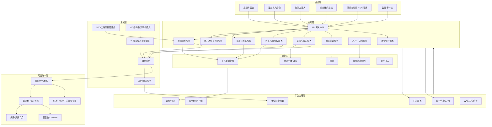
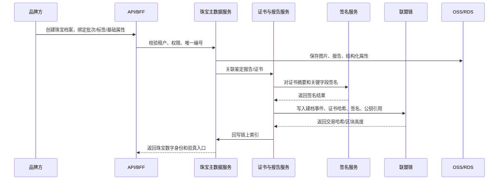
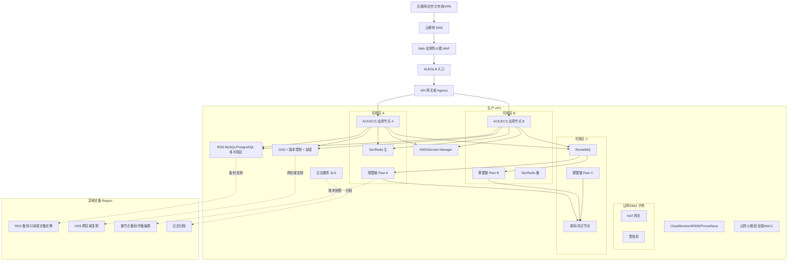

# 珠宝区块链跟踪系统技术方案

> 适用范围：基于附件任务包，在当前无既有仓库、无既有代码、无已部署环境的前提下，为“基于区块链技术的贵重物品（珠宝）跟踪系统”提供可落地的技术架构设计。本文不宣称任何云产品已经部署或验证；涉及阿里云产品能力、区域、配额、资质和价格的内容，实施前均需以阿里云官方文档、控制台可开通状态和商务确认为准。

---

## 1. 目标与假设

### 1.1 建设目标

建设一套面向珠宝全生命周期的可信追踪系统，覆盖生产/鉴定、入库、流转、销售、售后/转售等环节，使品牌方、鉴定机构、物流方、经销商、消费者、监管/审计方能够围绕同一件珠宝形成可验证、可审计、可追责的数字化记录。

核心目标：

1. 为每件珠宝建立唯一数字身份，绑定实物防伪标签、证书、图片、检测报告和关键业务事件。
2. 在多主体协作场景下提供不可篡改、可追溯、可验签的关键状态记录。
3. 明确链上/链下数据边界，避免隐私、商业秘密和大文件直接上链。
4. 在阿里云上构建可扩展、可观测、可备份、可容灾的 MVP 架构。
5. 支持消费者验真、机构审计、异常追踪、售后和二次流转。

### 1.2 合理假设

| 类别 | 假设 |
|---|---|
| 业务规模 | MVP 阶段服务 1 至 3 个品牌方、1 至 2 家鉴定机构、若干经销商和物流合作方。 |
| 商品规模 | MVP 首批 10 万件珠宝建档，日新增 1,000 至 5,000 件，日事件 1 万至 10 万条。 |
| 用户规模 | 内部和合作方操作用户 500 至 2,000 人；消费者验真以突发读取为主。 |
| 部署地域 | 默认部署在中国大陆阿里云单 Region 多可用区；异地灾备选择另一 Region。 |
| 区块链类型 | 默认采用联盟链；公链仅作为后续可选锚定层，不作为 MVP 主账本。 |
| 云服务策略 | 数据库、缓存、消息、对象存储、KMS、日志、监控优先采用阿里云托管服务；区块链节点可优先评估托管能力，不可用时采用 ACK/ECS 自建联盟链。 |
| 业务确认 | 未决策项不阻塞 MVP 设计，本文给出推荐默认值，并在“需业务确认”中列出。 |

---

## 2. 角色与职责边界

| 角色 | 主要职责 | 系统权限 |
|---|---|---|
| 品牌方 | 商品建档、生产批次管理、标签绑定、渠道授权、售后管理 | 创建商品、发起流转、查看品牌范围内全链路 |
| 鉴定机构 | 检测、评级、证书签发、复检 | 提交鉴定报告、签名证书摘要、撤销或更正鉴定结果 |
| 物流方 | 揽收、运输、到达、签收、异常上报 | 写入物流事件，不可修改商品主档 |
| 经销商/门店 | 入库、上架、销售、退换货、转售登记 | 更新托管权、销售状态和门店库存状态 |
| 消费者 | 扫码/NFC 验真、查看公开溯源信息、发起售后/转售 | 只读公开信息，可提交售后或转售申请 |
| 监管/审计方 | 抽检、审计、争议取证 | 按授权读取审计视图和链上证明 |
| 平台运营方 | 租户、权限、配置、风控、运维 | 管理平台能力，不直接篡改业务事实 |

---

## 3. 为什么使用区块链

### 3.1 要解决的信任问题

珠宝追踪的核心问题不是“存一份记录”，而是多方之间对记录真实性、完整性、时序和责任归属的信任问题：

1. 品牌方、鉴定机构、物流方、经销商是不同主体，单方数据库难以让其他方完全信任。
2. 珠宝价值高，证书伪造、调包、二次销售洗白、售后争议等风险高。
3. 鉴定报告、流转状态、所有权/托管权变化需要防篡改、可追溯、可验签。
4. 监管或审计需要独立验证关键事实是否在某个时间点已经存在。

区块链在本方案中承担“可信证据账本”职责：记录关键事件摘要、业务索引、状态变更、签名、公钥证书引用和链下文件哈希，用于证明“谁在什么时间对哪件珠宝做了什么声明”。

### 3.2 不上链的内容

以下内容不直接上链：

1. 消费者姓名、手机号、证件号、地址等个人信息。
2. 珠宝成本价、供货价、渠道政策、库存敏感信息等商业秘密。
3. 原始图片、视频、检测报告 PDF、大文件。
4. 内部审批备注、风控模型结果明细。
5. 可被链下权限控制替代的高频临时状态。

这些数据进入链下业务库、对象存储或加密存储；链上仅保存摘要、索引、关键状态和签名证明。

### 3.3 联盟链/公链/混合方案取舍

| 方案 | 优点 | 缺点 | 结论 |
|---|---|---|---|
| 公链 | 全球公开可验证，抗审查强 | 隐私差，成本和性能不稳定，合规与密钥治理复杂，业务数据难以撤回 | 不作为 MVP 主账本 |
| 联盟链 | 权限可控，性能稳定，适合多机构协作，便于合规治理 | 需要治理节点、证书、运维和准入机制 | 推荐作为 MVP 主方案 |
| 混合方案 | 联盟链承载业务，定期将区块根/状态根锚定到公链或第三方存证 | 架构复杂，成本增加，需明确合规边界 | 后续增强选项 |

推荐默认值：MVP 使用联盟链。后续如需提升公众可验证性，可每天或每小时将联盟链区块高度、区块哈希、批次 Merkle Root 锚定到公链或第三方存证服务，但不在 MVP 强制建设。

---

## 4. 总体技术架构



### 4.1 分层职责

| 层级 | 职责 |
|---|---|
| 业务层 | 提供不同参与方的操作入口和查询入口。 |
| 应用层 | 承载业务规则、权限校验、状态机、数据编排、验真查询和运营管理。 |
| 集成层 | 处理异步事件、外部系统接入、防伪标签接入、签名验签和协议适配。 |
| 可信账本层 | 记录关键业务事件摘要、状态证明、签名证明和链下数据哈希。 |
| 数据层 | 保存业务明细、文件、索引、缓存和审计日志。 |
| 平台治理层 | 提供安全、密钥、权限、监控、日志、备份、容灾和运维能力。 |

---

## 5. 关键业务流程

### 5.1 珠宝建档与鉴定



### 5.2 流转、销售与验真

1. 品牌方发起出库事件，指定经销商或物流方为下一托管方。
2. 物流方写入揽收、运输、到达、签收等物流事件。
3. 经销商确认入库，系统更新托管权。
4. 销售时经销商登记销售事件，所有权从品牌/经销商转移至消费者，链上记录所有权变更摘要。
5. 消费者扫码或读取 NFC，系统展示公开溯源视图，校验标签状态、证书哈希、关键事件签名和链上状态。
6. 若发生售后、维修、退换货或二次转售，系统追加事件，不覆盖历史事实。

### 5.3 异常处理

| 异常 | 处理策略 |
|---|---|
| 标签重复扫描 | 记录扫描上下文，触发风险规则，必要时冻结公开验真状态。 |
| 标签丢失/损坏 | 需品牌方或授权机构发起换标，链上记录旧标作废和新标绑定事件。 |
| 鉴定报告撤销 | 原报告不可删除，追加撤销事件和新报告摘要。 |
| 物流签收争议 | 保留物流方签名事件、图片或交接凭据哈希，进入争议处理流程。 |
| 链写入失败 | 业务事件先进入待上链状态，通过消息重试；超过阈值后告警并限制对外声明为“已上链”。 |

---

## 6. 珠宝唯一身份与防伪设计

### 6.1 唯一身份

每件珠宝使用全局唯一的 `jewelry_uid`，建议格式：

```text
JWL-{tenant_code}-{yyyyMMdd}-{random_or_sequence}-{check_digit}
```

配套身份标识：

| 标识 | 用途 |
|---|---|
| `jewelry_uid` | 平台内主身份，贯穿全生命周期。 |
| `asset_did` | 可选 DID 形式身份，用于跨机构验证和未来开放生态。 |
| `tag_id` | NFC/二维码标签 ID，可换标但必须留痕。 |
| `certificate_id` | 鉴定证书编号，可能存在多个版本。 |
| `chain_asset_id` | 链上资产 ID，映射 `jewelry_uid` 的哈希或脱敏索引。 |

推荐默认值：MVP 以 `jewelry_uid` 作为业务主键，链上使用 `hash(jewelry_uid + tenant_salt)` 作为资产索引，避免直接暴露品牌方业务编码。

### 6.2 标签方案

| 标签 | 用途 | 说明 |
|---|---|---|
| 动态二维码 | 低成本验真入口 | 二维码仅承载短链接或随机 token，不直接暴露完整信息。 |
| NFC 防拆标签 | 高价值珠宝默认推荐 | 支持唯一芯片 ID、防拆检测、近场读取。 |
| 激光微雕/物理特征 | 辅助防伪 | 可与图片特征、检测报告共同形成实物绑定证据。 |

标签绑定原则：

1. 标签 ID 与珠宝身份绑定事件必须上链记录摘要。
2. 标签换绑、作废、补发必须追加链上事件。
3. 消费者扫码时必须校验标签状态、扫码风险、链上资产状态和证书摘要。
4. NFC 芯片能力需在采购阶段确认，包括 UID 可读性、防克隆能力、防拆能力和 SDK 支持。

---

## 7. 链上/链下数据模型

### 7.1 链上数据边界

链上只保存可公开或可授权验证的证据摘要：

| 数据 | 是否上链 | 说明 |
|---|---:|---|
| 珠宝链上资产 ID | 是 | 使用脱敏哈希或链上专用 ID。 |
| 事件类型、事件时间、提交方机构 ID | 是 | 用于追踪时序和责任归属。 |
| 关键状态 | 是 | 如已建档、已鉴定、在途、已售、售后中、已作废。 |
| 证书/报告哈希 | 是 | 原文件在 OSS，链上保存哈希和版本。 |
| 图片/视频哈希 | 是 | 仅保存摘要，不保存原文件。 |
| 业务单据号哈希 | 是 | 避免暴露订单、物流单等敏感编号。 |
| 操作方签名、公钥证书引用 | 是 | 用于不可抵赖和验签。 |
| 消费者个人信息 | 否 | 仅在链下加密保存或脱敏保存。 |
| 价格、渠道、库存策略 | 否 | 商业敏感信息不直接上链。 |

### 7.2 链下核心表设计

| 对象/表 | 核心字段 | 说明 |
|---|---|---|
| `jewelry_asset` | `id`, `tenant_id`, `jewelry_uid`, `chain_asset_id`, `category`, `material`, `weight`, `status`, `created_at` | 珠宝主档。 |
| `jewelry_tag` | `id`, `jewelry_id`, `tag_id`, `tag_type`, `status`, `bound_at`, `revoked_at` | 标签绑定和换标记录。 |
| `certificate` | `id`, `jewelry_id`, `issuer_id`, `certificate_no`, `version`, `file_oss_key`, `file_hash`, `status` | 证书和检测报告。 |
| `trace_event` | `id`, `jewelry_id`, `event_type`, `actor_org_id`, `event_time`, `payload_json`, `payload_hash`, `chain_tx_hash`, `chain_status` | 追踪事件主表。 |
| `custody_record` | `id`, `jewelry_id`, `from_org_id`, `to_org_id`, `custody_type`, `effective_at`, `chain_tx_hash` | 托管权变化。 |
| `ownership_record` | `id`, `jewelry_id`, `owner_type`, `owner_ref_hash`, `effective_at`, `privacy_level` | 所有权变化，消费者身份脱敏或加密引用。 |
| `scan_record` | `id`, `jewelry_id`, `tag_id`, `scan_time`, `geo_hash`, `device_fingerprint_hash`, `risk_level` | 验真扫描与风险分析。 |
| `chain_anchor` | `id`, `chain_height`, `block_hash`, `anchor_target`, `anchor_tx_hash`, `created_at` | 可选公链/第三方存证锚定。 |

### 7.3 追踪事件模型

统一事件结构：

```json
{
  "event_id": "evt_唯一ID",
  "jewelry_uid_hash": "脱敏后的珠宝身份索引",
  "event_type": "CERTIFIED | STORED | SHIPPED | RECEIVED | SOLD | AFTERSALE | RESOLD | REVOKED",
  "actor_org_id": "提交方机构ID",
  "actor_role": "BRAND | CERT_ORG | LOGISTICS | DEALER | CONSUMER | AUDITOR",
  "event_time": "2026-10-22T14:30:00Z",
  "business_ref_hash": "业务单据号哈希",
  "payload_hash": "链下明细JSON规范化后的哈希",
  "file_hashes": ["证书或图片哈希"],
  "prev_event_hash": "上一关键事件哈希",
  "signature": "提交方签名",
  "public_key_ref": "公钥/证书引用",
  "privacy_level": "PUBLIC | AUTHORIZED | PRIVATE"
}
```

### 7.4 状态机

| 当前状态 | 事件 | 目标状态 |
|---|---|---|
| `DRAFT` | 建档完成 | `REGISTERED` |
| `REGISTERED` | 鉴定通过 | `CERTIFIED` |
| `CERTIFIED` | 入库 | `IN_STOCK` |
| `IN_STOCK` | 出库/发运 | `IN_TRANSIT` |
| `IN_TRANSIT` | 签收 | `DEALER_RECEIVED` |
| `DEALER_RECEIVED` | 销售 | `SOLD` |
| `SOLD` | 售后申请 | `AFTERSALE` |
| `AFTERSALE` | 售后完成 | `SOLD` 或 `REVOKED` |
| `SOLD` | 转售登记 | `RESOLD` |
| 任意有效状态 | 作废/确认为假 | `REVOKED` |

---

## 8. 智能合约/链码设计

### 8.1 合约职责

智能合约只处理关键事实和状态约束，不承载复杂业务查询：

1. 注册链上资产。
2. 追加追踪事件。
3. 校验事件提交方是否具备对应角色权限。
4. 维护关键状态流转。
5. 保存证书、报告、图片、单据等链下文件摘要。
6. 记录标签绑定、换绑、作废。
7. 提供按链上资产 ID 查询关键状态和事件摘要的能力。

### 8.2 合约接口草案

| 方法 | 用途 |
|---|---|
| `RegisterAsset(assetId, tenantHash, initialHash, signature)` | 创建链上资产。 |
| `BindTag(assetId, tagHash, tagType, payloadHash, signature)` | 绑定防伪标签。 |
| `AppendTraceEvent(assetId, eventType, payloadHash, fileHashes, prevHash, signature)` | 追加追踪事件。 |
| `TransferCustody(assetId, fromOrg, toOrg, refHash, signature)` | 记录托管权变化。 |
| `TransferOwnership(assetId, ownerRefHash, refHash, signature)` | 记录所有权变化。 |
| `RevokeTag(assetId, oldTagHash, reasonHash, signature)` | 作废标签。 |
| `UpdateCertificate(assetId, certHash, issuerOrg, version, signature)` | 更新证书摘要。 |
| `GetAssetState(assetId)` | 查询链上关键状态。 |
| `GetEventProof(assetId, eventId)` | 查询事件证明。 |

### 8.3 背书与权限

推荐 MVP 背书策略：

| 事件 | 背书要求 |
|---|---|
| 建档 | 品牌方节点背书，平台节点见证。 |
| 鉴定 | 鉴定机构节点背书，品牌方节点可联合背书。 |
| 物流事件 | 物流方节点背书，平台节点见证。 |
| 销售 | 经销商节点背书，品牌方或平台节点见证。 |
| 作废/撤销 | 原提交方和品牌方联合背书，必要时平台运营审批。 |

---

## 9. 接口与事件设计

### 9.1 外部 API 分组

| API 分组 | 典型接口 | 调用方 |
|---|---|---|
| 珠宝主档 | 创建珠宝、查询珠宝、更新基础属性 | 品牌方 |
| 鉴定证书 | 上传报告、签发证书、撤销证书 | 鉴定机构 |
| 标签管理 | 绑定标签、换标、作废标签 | 品牌方、授权门店 |
| 物流接入 | 推送物流事件、查询接入结果 | 物流方 |
| 流转销售 | 出库、入库、销售、退换货 | 品牌方、经销商 |
| 消费者验真 | 扫码验真、查看公开溯源、提交售后 | 消费者端 |
| 审计查询 | 查询事件证明、导出审计材料 | 监管/审计方 |
| 运维管理 | 租户、机构、角色、链节点、风控规则 | 平台运营方 |

### 9.2 内部事件

| 事件名 | 触发时机 | 消费方 |
|---|---|---|
| `JewelryRegistered` | 珠宝建档成功 | 上链服务、搜索索引、审计日志 |
| `CertificateIssued` | 鉴定证书签发 | 上链服务、验真服务 |
| `TagBound` | 标签绑定 | 上链服务、风控服务 |
| `TraceEventCreated` | 追踪事件创建 | 上链服务、通知服务、搜索索引 |
| `CustodyTransferred` | 托管权变化 | 上链服务、库存服务 |
| `OwnershipTransferred` | 所有权变化 | 上链服务、消费者视图 |
| `ChainTxConfirmed` | 链交易确认 | 业务服务回写链上索引 |
| `RiskDetected` | 风险规则命中 | 运营后台、告警系统 |

### 9.3 幂等与一致性

1. 外部写接口必须要求 `Idempotency-Key` 或业务唯一单号。
2. 链下数据库先记录业务事件为 `PENDING_CHAIN`。
3. 上链服务异步消费事件，写链成功后回写 `chain_tx_hash`、`block_height` 和 `CONFIRMED`。
4. 消费者展示时区分“已记录待上链”和“已上链确认”，避免过度承诺。
5. 消息消费按 `event_id` 幂等，合约按 `event_id` 或 `payload_hash` 防重复提交。

---

## 10. 阿里云部署架构



### 10.1 部署说明

1. 入口层：公网流量经 DNS、WAF、ALB/SLB、API 网关或 Ingress 进入应用。
2. 网络层：应用、数据库、缓存、消息和链节点部署在 VPC 私网，按安全组和子网隔离。
3. 计算层：MVP 推荐 ACK 承载微服务；团队 Kubernetes 能力不足时可先用 ECS + 容器/进程部署。
4. 数据层：RDS 多可用区部署，OSS 开启服务端加密、版本控制和生命周期归档。
5. 账本层：联盟链节点独立部署，至少跨 2 至 3 个可用区；不同机构节点可独立 VPC 或独立账号部署，通过专线/VPN/公网白名单互联。
6. 运维层：SLS 采集日志，ARMS/Prometheus 监控应用与链节点，CloudMonitor 监控云资源。
7. 灾备层：数据库、OSS、账本快照和配置定期复制到异地 Region。

---

## 11. 阿里云基础依赖清单

| 能力 | 级别 | 推荐云服务 | 用途 | 部署建议 | 替代方案 |
|---|---|---|---|---|---|
| DNS | 必选 | 云解析 DNS | 域名解析、流量入口 | 生产域名独立管理，开启解析监控 | 第三方 DNS |
| Web 防护 | 必选 | Web 应用防火墙 WAF | 防 SQL 注入、XSS、恶意请求 | 公网入口前置，配置基础防护和 Bot 策略 | Nginx ModSecurity、自建网关 |
| 负载均衡 | 必选 | ALB/CLB/NLB | HTTP/API 入口和服务转发 | 多可用区实例，配合健康检查 | 自建 Nginx/HAProxy |
| API 管理 | 必选 | API 网关或 ACK Ingress | 认证、限流、路由、合作方 API 暴露 | 外部开放 API 优先 API 网关，内部服务走 Ingress | Kong、APISIX、自建网关 |
| 计算 | 必选 | ACK | 微服务容器编排 | 生产至少 2 个可用区节点池 | ECS、Serverless 应用引擎 SAE |
| 关系数据库 | 必选 | RDS MySQL 或 RDS PostgreSQL | 业务主数据、事件、权限、订单索引 | 多可用区，高可用版，开启备份和审计 | PolarDB、OceanBase、ECS 自建数据库 |
| 缓存 | 必选 | Tair/云数据库 Redis | 验真热点缓存、会话、限流 | 主备或集群版，开启持久化和白名单 | KeyDB/ECS 自建 Redis |
| 消息队列 | 必选 | 云消息队列 RocketMQ | 异步上链、事件分发、削峰 | 生产独立实例，按事件主题隔离 | Kafka、RabbitMQ、EventBridge |
| 对象存储 | 必选 | OSS | 图片、证书 PDF、检测报告、导出文件 | 开启服务端加密、版本控制、生命周期、跨区域复制 | NAS、MinIO、自建对象存储 |
| 密钥管理 | 必选 | KMS + Secrets Manager | 数据加密密钥、签名私钥保护、凭据管理 | 生产密钥分用途隔离，启用轮换策略 | HSM、Vault、自建 KMS |
| 身份权限 | 必选 | RAM | 云资源权限、最小授权 | 子账号/角色分离，禁止长期 AccessKey 泛用 | 企业 IdP + STS |
| 日志 | 必选 | 日志服务 SLS | 应用日志、审计日志、链节点日志 | 日志分类采集，设置保留周期和投递归档 | ELK/OpenSearch 自建 |
| 监控/APM | 必选 | CloudMonitor、ARMS、Managed Prometheus | 云资源、应用、链节点指标和告警 | 关键链路配置 SLO 告警 | Grafana + Prometheus 自建 |
| 搜索分析 | 后期可选 | OpenSearch 或 Elasticsearch 兼容服务 | 追踪事件检索、审计检索 | MVP 可先用 RDS 索引，数据量增长后引入 | ClickHouse、Hologres |
| 安全边界 | 必选 | 云防火墙、安全组、NACL | 网络访问控制 | 生产按最小开放端口配置 | 自建防火墙 |
| 运维接入 | 按需 | 堡垒机 | 运维审计和主机登录 | 禁止直接暴露 SSH/RDP | VPN + 自建审计 |
| IoT 接入 | 按需 | IoT Platform | NFC/设备/扫码设备接入 | 仅在存在硬件设备直连时引入 | 合作方 API、MQTT 自建 |
| 区块链托管 | 按需 | 阿里云可用的区块链托管能力需实施前核实 | 若账号和区域可用，可降低链节点运维成本 | 上线前确认产品可用性、区域、版本、计费和 SLA | ACK/ECS 自建 Hyperledger Fabric 或 FISCO BCOS |
| 备份容灾 | 必选 | DBS、RDS 备份、OSS 跨区域复制 | 数据备份、恢复、归档 | 设定 RPO/RTO，定期演练 | 自建备份脚本和异地存储 |
| 数据传输 | 按需 | DTS | 数据迁移、同步、灾备 | 跨 Region 数据同步前确认链路和费用 | 自建 binlog/逻辑复制 |
| 内容分发 | 后期可选 | CDN | 消费者端静态资源和公开图片加速 | 公开资源走 CDN，私有文件用签名 URL | OSS 直出 |

---

## 12. 区块链基础设施选型

### 12.1 推荐默认方案

MVP 推荐：自建联盟链优先采用 Hyperledger Fabric 部署在 ACK/ECS，实施前同时评估阿里云当前区域是否提供可用的区块链托管服务。

推荐理由：

1. 联盟链权限模型适合品牌方、鉴定机构、物流方、经销商多主体协作。
2. Fabric 的 MSP、CA、背书策略、通道、私有数据集合适合机构准入和权限治理。
3. 自建在 ACK/ECS 上可控性高，避免托管产品区域或可用性不确定导致 MVP 卡住。
4. 如果托管区块链服务可用，可在 PoC 后替换节点运维方式，但业务数据模型和链码接口保持一致。

可替代：FISCO BCOS 也适合联盟链场景，在国内社区和金融政企场景较常见。若实施团队更熟悉 FISCO BCOS，可将链码/合约层改为 Solidity/Java 合约模型，整体架构不变。

### 12.2 节点规划

| 阶段 | 节点建议 |
|---|---|
| PoC | 单机构 1 至 2 Peer、1 组排序节点、测试 CA。 |
| MVP | 品牌方、鉴定机构、平台方各至少 1 个 Peer；排序节点 3 个跨可用区。 |
| 生产增强 | 物流方、核心经销商可独立 Peer；关键机构独立云账号/VPC 部署。 |
| 审计增强 | 审计方可部署只读节点或定期接收区块快照。 |

---

## 13. 安全与合规设计

### 13.1 身份认证与授权

1. 内部和合作方后台使用企业账号、MFA、RBAC。
2. 外部 API 使用 OAuth2 Client Credentials、mTLS 或签名请求。
3. 消费者验真使用短链 token，不要求登录即可查看公开信息；售后、转售等涉及个人权益的操作需登录。
4. 机构准入需绑定组织证书、链上 MSP 身份和平台租户身份。
5. 所有后台敏感操作进入审计日志。

### 13.2 数字签名

1. 机构提交关键事件前，对规范化后的事件 payload 计算哈希并签名。
2. 私钥优先托管在 KMS/HSM；不允许在应用配置中明文保存私钥。
3. 签名算法选择需结合链平台支持，默认采用国密或 ECDSA 方案，实施前由合规和链平台能力确认。
4. 公钥证书、证书版本和撤销状态需要可查询。
5. 验真时同时校验链上摘要、签名、公钥证书状态和链下文件哈希。

### 13.3 隐私与数据保护

1. 个人信息链下保存，按字段加密或脱敏。
2. 消费者身份在所有权记录中使用加盐哈希或加密引用。
3. OSS 私有 Bucket，不直接公开原始报告；消费者访问使用短时签名 URL 或后端代理。
4. 日志禁止输出身份证号、手机号、详细地址、完整证书文件内容、密钥和签名私钥。
5. 数据分级：公开溯源信息、授权机构信息、内部敏感信息、个人敏感信息分级管理。

### 13.4 合规注意事项

1. 实施前确认《个人信息保护法》《数据安全法》《网络安全法》相关要求。
2. 若涉及跨境经销、跨境消费者或境外机构节点，需评估数据出境和跨境访问。
3. 鉴定机构资质、电子签章法律效力、区块链存证法律认可程度需由法务确认。
4. 若引入公链锚定，需确认监管合规、数据不可删除风险和费用波动。

---

## 14. 可用性、容灾与备份

### 14.1 可用性目标

| 指标 | MVP 目标 | 生产增强目标 |
|---|---:|---:|
| 核心后台 API 可用性 | 99.5% | 99.9% |
| 消费者验真查询可用性 | 99.9% | 99.95% |
| 链上写入确认延迟 | P95 小于 10 秒 | P95 小于 5 秒 |
| 链下查询延迟 | P95 小于 500 ms | P95 小于 300 ms |
| RPO | 小于 15 分钟 | 小于 5 分钟 |
| RTO | 小于 4 小时 | 小于 1 小时 |

### 14.2 容灾策略

1. 应用服务跨可用区部署，至少 2 个副本。
2. RDS 使用多可用区高可用版，开启自动备份和日志备份。
3. OSS 开启版本控制、服务端加密、生命周期和跨区域复制。
4. Redis 使用主备或集群版，缓存可重建，不作为唯一事实来源。
5. 链节点定期备份账本数据、链码、通道配置、MSP/CA 配置。
6. 异地灾备环境保留基础网络、数据库备份、对象存储副本和链节点恢复脚本。
7. 定期演练单节点故障、可用区故障、数据库恢复、链节点恢复和对象存储误删恢复。

### 14.3 回滚策略

| 场景 | 回滚方式 |
|---|---|
| 应用发布失败 | 蓝绿/滚动回滚至上一镜像版本。 |
| 数据库变更失败 | 采用向前兼容变更，避免破坏性 DDL；必要时执行回滚脚本。 |
| 合约升级失败 | 合约版本化，旧版本保留；新事件暂停写入，待修复后重放。 |
| 上链服务故障 | 业务事件保留待上链状态，修复后按幂等键重试。 |
| 错误业务事件上链 | 不删除链上记录，追加更正/撤销事件。 |

---

## 15. 可观测性与审计

### 15.1 指标

| 类型 | 指标 |
|---|---|
| 业务指标 | 建档数量、鉴定数量、销售数量、验真次数、异常扫码次数、换标次数 |
| 链路指标 | API P95/P99、错误率、消息积压、上链成功率、上链确认延迟 |
| 区块链指标 | 区块高度、出块间隔、交易吞吐、Peer 状态、排序节点状态、背书失败率 |
| 数据指标 | RDS CPU/IOPS/连接数、慢查询、Redis 命中率、OSS 访问失败率 |
| 安全指标 | 登录失败、权限拒绝、异常 API 访问、WAF 命中、密钥调用异常 |

### 15.2 日志与审计

1. 应用日志进入 SLS，按服务、租户、Trace ID、事件 ID 检索。
2. 审计日志独立保存，记录操作者、机构、IP、设备、操作、对象、结果。
3. 链节点日志、合约执行日志、上链服务日志统一接入监控。
4. 消费者验真请求记录脱敏地理位置和设备指纹哈希，用于风险分析。
5. 审计日志保留周期按合规要求确认，MVP 默认不少于 180 天，关键存证长期归档。

---

## 16. 容量与性能估算

### 16.1 MVP 容量假设

| 项目 | 估算 |
|---|---:|
| 珠宝资产 | 100,000 件 |
| 平均每件事件数 | 10 至 30 条 |
| 追踪事件总量 | 1,000,000 至 3,000,000 条 |
| 日新增事件 | 10,000 至 100,000 条 |
| 消费者验真峰值 | 100 至 500 QPS |
| 后台写入峰值 | 20 至 100 TPS |
| 单件图片/报告 | 5 MB 至 50 MB |
| 首年 OSS 存储 | 5 TB 至 20 TB |

### 16.2 性能设计

1. 写入链路采用异步上链，避免后台业务操作被链确认阻塞。
2. 消费者验真读链结果使用缓存和链下索引，必要时后台异步校验证据。
3. 追踪事件表按 `tenant_id`、`jewelry_id`、`event_time` 建索引。
4. 大文件全部走 OSS，数据库只存元数据、哈希和访问控制信息。
5. 热门验真页面可缓存公开视图，但必须携带链上确认状态和缓存时间。
6. 消息队列按事件类型拆分 Topic，避免低优先级任务阻塞上链主链路。

---

## 17. 成本驱动因素

| 成本项 | 主要驱动 |
|---|---|
| 计算 | 微服务副本数、ACK/ECS 规格、链节点数量。 |
| 数据库 | RDS 规格、存储量、备份保留期、读写峰值。 |
| 对象存储 | 图片/视频/报告体积、访问频率、跨区域复制。 |
| 消息队列 | Topic 数、消息量、保留时间。 |
| 区块链 | Peer/排序节点数量、跨机构部署、托管服务费用或 ECS/ACK 成本。 |
| 安全 | WAF、KMS、堡垒机、云防火墙、审计日志保留。 |
| 监控日志 | SLS 写入量、索引量、保存周期、ARMS/APM 采样率。 |
| 公网流量 | 消费者验真、报告下载、CDN 回源、跨 Region 同步。 |

MVP 成本控制建议：

1. 先采用单 Region 多可用区，不立即建设热备双活。
2. OSS 大文件设置生命周期，历史大文件转低频或归档存储。
3. 链节点数量按核心机构最小集合建设。
4. 日志分级保留，调试日志短周期，审计日志长期归档。
5. 公链锚定暂不进入 MVP，待业务价值明确后再引入。

---

## 18. MVP 技术栈建议

| 层级 | 推荐 |
|---|---|
| 前端 | 管理后台 Web + 消费者 H5/小程序验真页。 |
| 后端 | Java Spring Boot、Go 或 Node.js 均可；推荐团队熟悉栈优先。 |
| API | REST 为主，合作方批量接入可补充异步 API/Webhook。 |
| 数据库 | RDS MySQL 或 PostgreSQL。 |
| 缓存 | Tair/Redis。 |
| 消息 | RocketMQ。 |
| 对象存储 | OSS。 |
| 区块链 | Hyperledger Fabric on ACK/ECS；托管区块链服务可用时作为备选。 |
| 身份权限 | RBAC + 租户隔离 + 机构证书。 |
| 签名密钥 | KMS/Secrets Manager，必要时 HSM。 |
| 监控日志 | SLS + CloudMonitor + ARMS/Prometheus。 |
| 部署 | ACK + Helm/GitOps，或 ECS + 容器作为简化起步。 |

---

## 19. MVP 分期路线

### 阶段 0：PoC 验证，2 至 4 周

目标：

1. 打通珠宝建档、证书上传、事件上链、验真查询闭环。
2. 验证链上/链下哈希一致性。
3. 验证签名、验签、证书撤销或版本化流程。
4. 输出云产品可用性核实结果和成本初估。

验收指标：

1. 可创建测试珠宝并生成唯一身份。
2. 可上传证书并生成哈希。
3. 可成功写入联盟链并查询交易证明。
4. 消费者页面可展示公开溯源和链上确认状态。

### 阶段 1：MVP 上线，6 至 10 周

目标：

1. 建设品牌方、鉴定机构、经销商、消费者验真核心功能。
2. 支持标签绑定、建档、鉴定、入库、出库、销售、验真。
3. 建设异步上链、消息重试、审计日志、基础监控。
4. 完成单 Region 多可用区生产部署。

验收指标：

1. 10 万件珠宝建档能力。
2. 日 10 万追踪事件处理能力。
3. 消费者验真 P95 小于 500 ms。
4. 上链成功率大于 99.5%。
5. 关键业务事件可通过链上交易哈希验真。

### 阶段 2：生态接入，8 至 12 周

目标：

1. 接入物流方 API、更多鉴定机构和经销商。
2. 增强风控规则、异常扫码识别和争议处理。
3. 提供审计端和批量导出能力。
4. 完善灾备演练、链节点治理和机构准入流程。

验收指标：

1. 至少 2 类外部合作方稳定接入。
2. 风险事件可自动告警并形成处理闭环。
3. 完成一次恢复演练并达到 RTO/RPO 目标。

### 阶段 3：增强可信与开放能力

目标：

1. 可选引入公链或第三方存证锚定。
2. 支持二次转售、维修保养、保险、质押等扩展场景。
3. 建设开放 API 和合作方开发者门户。
4. 引入更强的实物识别能力，如高精度图像特征、NFC 防克隆芯片能力。

---

## 20. 风险与缓解

| 风险 | 影响 | 缓解 |
|---|---|---|
| 托管区块链服务区域不可用 | 影响选型和上线计划 | MVP 默认保留 ACK/ECS 自建联盟链兜底。 |
| 标签被复制或转移 | 实物防伪失效 | 采用 NFC 防拆标签、扫码风控、换标留痕、实物特征辅助。 |
| 链上写入延迟或失败 | 影响可信状态确认 | 异步上链、重试队列、待上链状态、告警和补偿任务。 |
| 隐私数据误上链 | 不可删除，合规风险高 | 严格链上字段白名单、代码审查、测试用例和上线门禁。 |
| 多机构治理复杂 | 节点准入、证书、背书策略难管理 | MVP 先引入少量核心机构，逐步扩展治理章程。 |
| 证书或报告更正 | 历史记录不能修改 | 追加撤销/更正事件，保留完整版本链。 |
| 消费者误解“上链”等于绝对真品 | 声誉和法律风险 | 页面文案说明链上证明范围，实物鉴定仍以授权机构报告为准。 |
| OSS 原文件泄露 | 隐私和商业风险 | 私有 Bucket、签名 URL、KMS 加密、访问审计。 |
| 成本超预期 | 影响商业可持续性 | 分阶段建设，控制节点数、日志周期、大文件生命周期。 |

---

## 21. 需业务确认事项

| 事项 | 影响 | 推荐默认值 |
|---|---|---|
| 首批接入机构名单 | 决定联盟链组织、节点和背书策略 | 品牌方、平台方、1 家鉴定机构先接入。 |
| 是否要求公链锚定 | 影响合规、成本和架构复杂度 | MVP 不做，阶段 3 评估。 |
| 标签类型 | 影响防伪强度和单件成本 | 高价值珠宝使用 NFC 防拆标签，普通商品用动态二维码。 |
| 消费者公开展示范围 | 影响隐私和商业秘密 | 展示品牌、品类、证书状态、关键流转节点，不展示价格和完整物流地址。 |
| 鉴定机构电子签章法律要求 | 影响签名体系和证书格式 | 先采用机构数字证书签名，法务确认后接入合规电子签章。 |
| 是否支持二次转售 | 影响所有权模型和消费者身份处理 | MVP 保留模型字段，首期只做售后和转售登记入口。 |
| 灾备等级 | 影响成本 | MVP 单 Region 多可用区 + 异地备份，后续按业务 SLA 升级。 |
| 云服务地域 | 影响产品可用性和合规 | 选择主要业务所在地附近的中国大陆 Region，实施前核实产品可开通性。 |

---

## 22. 实施前核实清单

1. 阿里云目标 Region 是否支持所需 RDS、Redis/Tair、RocketMQ、KMS、WAF、SLS、ARMS、ACK 等服务。
2. 目标账号是否可开通区块链托管相关服务；如不可用，确认 ACK/ECS 自建方案。
3. NFC/二维码供应商的芯片能力、防拆能力、SDK、批量写码和成本。
4. 鉴定机构证书格式、签名能力、接口能力和法律资质。
5. 物流方 API 接入方式、签名方式、推送频率和异常补偿机制。
6. 个人信息和跨境数据处理的合规要求。
7. 预算上限、日志保留周期、灾备等级和 SLA。
8. 合约升级、机构准入、证书吊销和争议处理的治理规则。

---

## 23. 验收自检

| 验收条件 | 是否满足 | 说明 |
|---|---|---|
| 1. 技术架构说明业务层、应用层、集成层、可信账本层、数据层、平台治理层之间的职责和调用关系 | 满足 | 第 4 节给出 Mermaid 总体架构图和分层职责。 |
| 2. 部署架构说明 VPC、可用区、入口、安全边界、计算、数据、中间件、链节点、运维与跨区灾备 | 满足 | 第 10 节给出阿里云部署架构图和部署说明。 |
| 3. 清楚定义每件珠宝的唯一身份、追踪事件模型、所有权/托管权变化、签名与验真路径，以及链上只存摘要/索引/关键状态的边界 | 满足 | 第 6、7、8、9 节覆盖身份、事件、状态、签名、链上/链下边界。 |
| 4. 云服务清单能够支撑 MVP 落地，区分必选与可选依赖，并注明阿里云产品选择风险 | 满足 | 第 11 节列出云服务映射，第 12、20、22 节注明区块链托管可用性需核实并给出自建兜底。 |
| 5. 方案包含可执行的 MVP 技术栈建议、实施阶段和验收指标 | 满足 | 第 18、19 节给出技术栈、分期路线和阶段验收指标。 |
